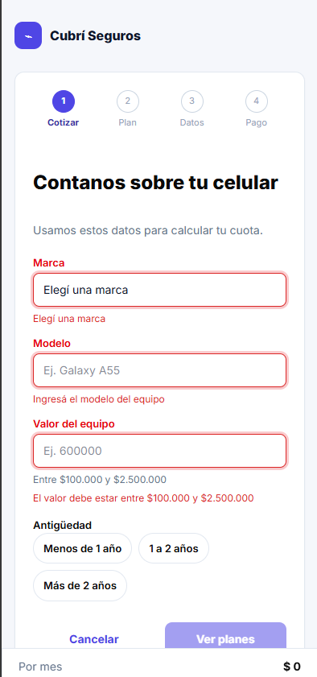
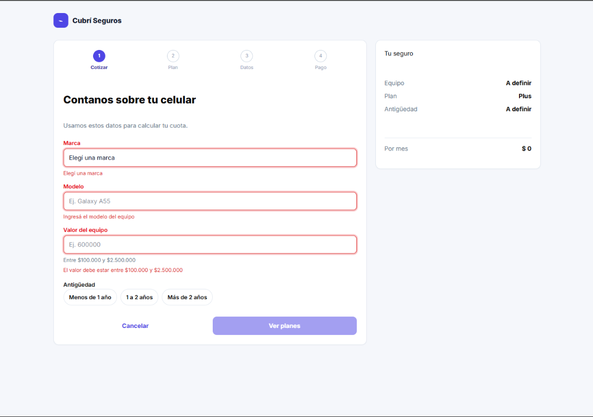
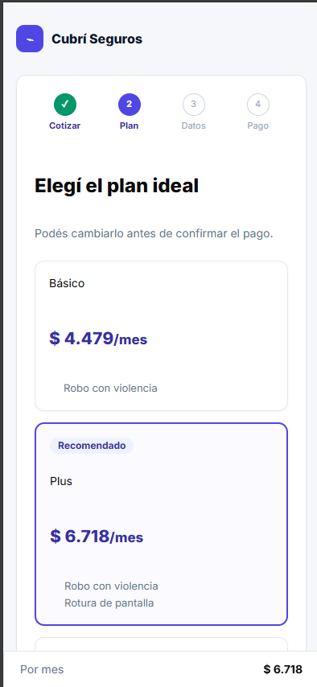
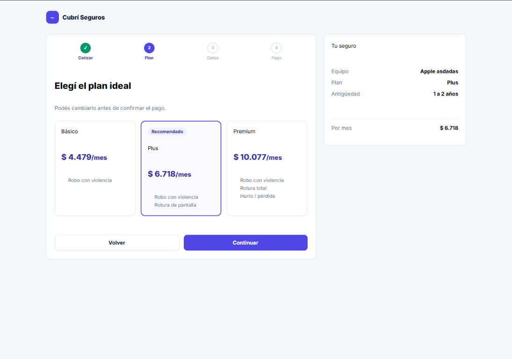
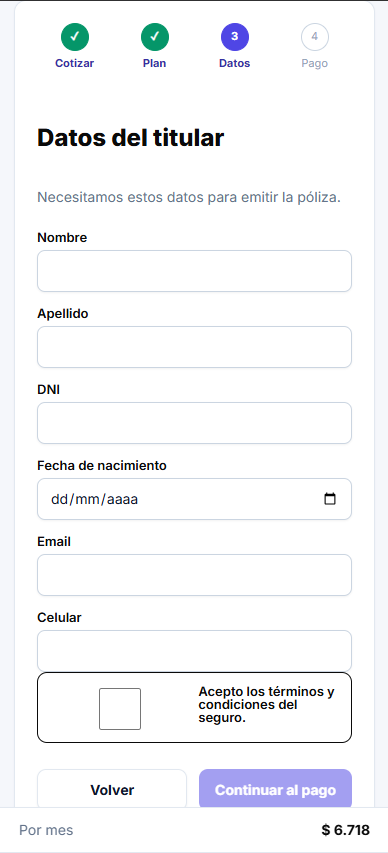
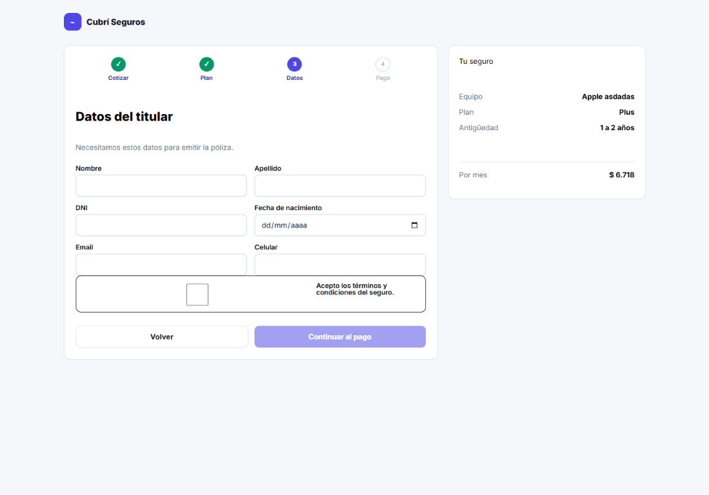
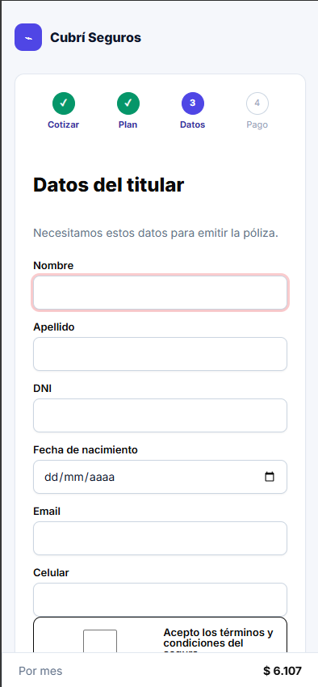
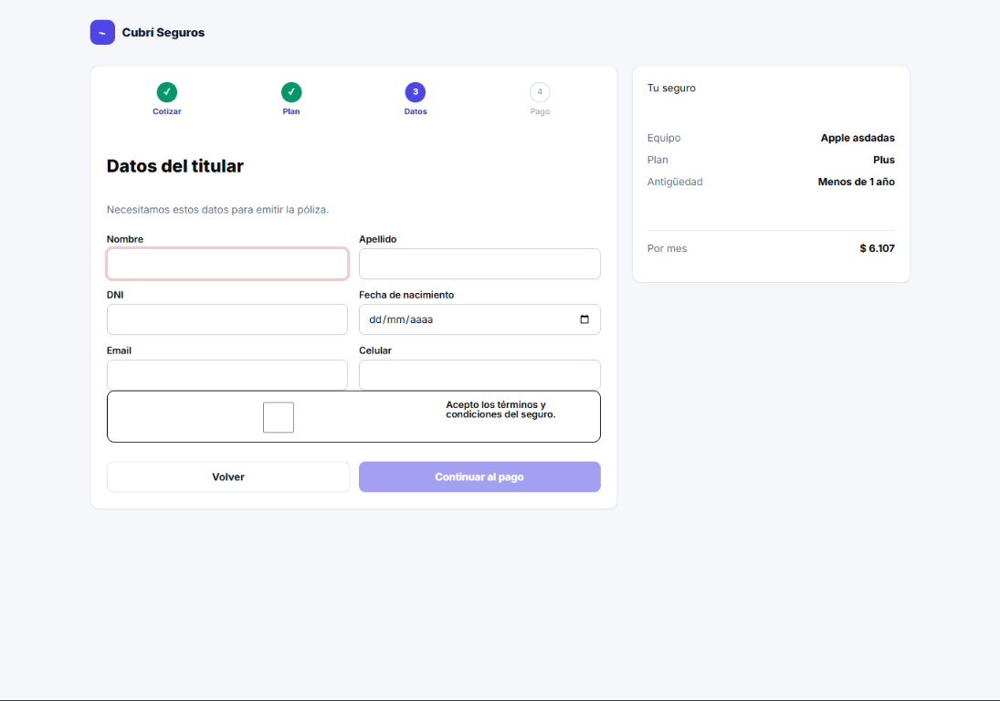
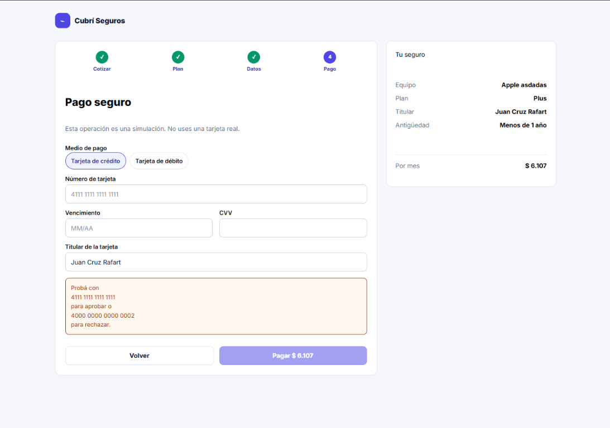

# Cubrí Seguros

Checkout de contratación digital de seguro de celular. HTML5, Tailwind CSS v4 (CDN), Basecoat UI y JavaScript vanilla (sin frameworks).

**Sitio publicado:** _pegar URL_

## Cómo ejecutarlo

No se abre con doble clic (el `fetch` de `data/planes.json` y los módulos ES lo bloquean). Usá **Live Server** de VS Code o, con Node:

```bash
npx serve .
```

## Estructura

```
index.html · css/tokens.css · data/planes.json
js/ app.js · estado.js · render.js · validaciones.js · cotizador.js · pago.js
```

## Pruebas rápidas

- $600.000, menos de 1 año: Básico $2.000 · Plus $3.000 · Premium $4.500
- $600.000, 1 a 2 años: $2.200 · $3.300 · $4.950
- $1.200.000, más de 2 años: $5.000 · $7.500 · $11.250
- Tarjeta `4111 1111 1111 1111`: aprobado. `4000 0000 0000 0002`: rechazado y vuelta al paso 4 con los datos conservados.

## Decisiones tomadas

- Un único objeto `solicitud` (`estado.js`) guarda todo el flujo; el DOM solo lo muestra.
- `index.html` tiene una `<section data-paso="0..6" hidden>` por pantalla; `render()` muestra la activa y la pinta desde el estado.
- La cuota se calcula solo en `calcularCuota()`; los planes se cargan con `fetch` desde `data/planes.json`.
- Validaciones como funciones puras; errores en blur, con `role="alert"`, `aria-invalid` y `aria-describedby`; foco al primer error al enviar.
- Mobile first: una columna y resumen en barra fija inferior; desde `lg:` (1024 px) dos columnas con resumen lateral de 380 px.
- El resumen se genera una sola vez (`resumen()`) para mobile y desktop.

## Capturas

### Cotización

**Mobile**



**Desktop**



### Selección del plan

**Mobile**



**Desktop**



### Datos del titular

**Mobile**



**Desktop**



### Validación del formulario

**Mobile**



**Desktop**



### Pago

**Desktop**




## Bonus realizados

Ninguno.
